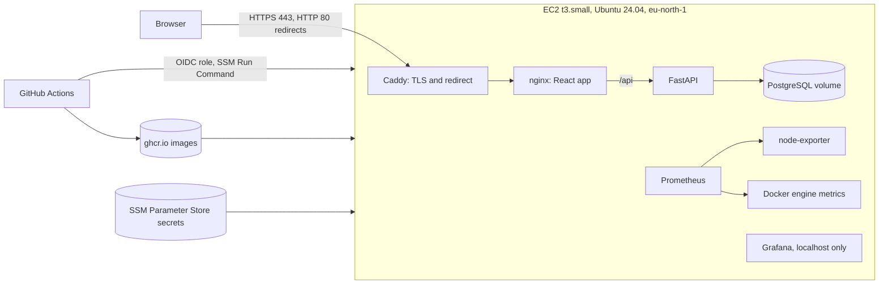

# votesecure-infra

Infrastructure and deploy notes for votesecure-fullstack (React, FastAPI, PostgreSQL) on AWS.
Built as hands-on practice: launched, hardened, deployed, monitored, then torn down to stop the cost.
Everything here was run for real. It is not a long-running production system.

## Architecture

## What is in this repo

- `main.tf`: provider, default tags (`Project=votesecure`) and the S3 backend (remote state with locking)
- `network.tf`, `vm.tf`, `userdata.sh`: security group, VM and Elastic IP, all created by Terraform
- `iam.tf`: the VM's role and instance profile (AmazonSSMManagedInstanceCore plus read access to `parameter/votesecure/*`)
- `parameters.tf`: the four Parameter Store SecureStrings as placeholders; the real values are set outside Terraform
- `ci.tf`: the GitHub OIDC provider and the `votesecure-ci-deploy` role, scoped by tag
- `variables.tf`, `terraform.tfvars.example`, `outputs.tf`: inputs (copy the example to `terraform.tfvars`) and outputs
- `.github/workflows/iac-scan.yml`: Checkov scan of the Terraform on every push and pull request
- `docker-compose.prod.yml`, `Caddyfile`: the app stack (db, api, web, caddy)
- `monitoring/`: Prometheus, Alertmanager (Telegram notifications), node-exporter and Grafana, listening on 127.0.0.1 only and reached through an SSH tunnel
- `scripts/`: `deploy.sh`, `backup.sh`, `monitoring-up.sh`, `provision.sh`

## How a deploy works

A merge to `main` in the app repo builds the images, scans them with Trivy and pushes them tagged with the commit SHA. The deploy job then assumes an AWS role through OIDC, with no stored keys and a trust policy pinned to the repo's immutable subject and its main branch. SSM Run Command runs `deploy.sh` on the VM. The script fetches secrets from Parameter Store into a RAM-disk file, logs in to ghcr.io, pulls, restarts, health-checks over HTTPS, rolls back on failure and deletes the temporary files.

## Security notes

- SSH by key only, root login off, ufw default deny, fail2ban; the security group allows SSH only from my own IP
- Secrets live only in Parameter Store (SecureString) and never in Git; values are set outside Terraform, but Terraform's state can hold them after a refresh, so the state bucket is private, versioned and encrypted
- Only Caddy publishes ports (80 and 443); db, api and web stay internal
- IMDSv2 required; the CI role can run the AWS-RunShellScript document only on instances tagged `Project=votesecure`
- Monitoring listens on localhost only
- Checkov scans the Terraform in CI; four findings are skipped on purpose, each with its reason written next to the code

## Rebuild from scratch

Prerequisites, done by hand once:

- AWS account with MFA and an IAM admin user, the AWS CLI, the GitHub CLI and Terraform 1.10 or newer
- The state bucket, the one thing Terraform cannot create for itself. Create it with `BUCKET=votesecure-tfstate-$(aws sts get-caller-identity --query Account --output text)`, then `aws s3api create-bucket --bucket $BUCKET --region eu-north-1 --create-bucket-configuration LocationConstraint=eu-north-1`, then block public access and enable versioning on it
- Optional: a DNS name for Caddy's HTTPS certificate, pointing at the Elastic IP; without one, use lab mode (see the limits below)

Steps:

1. Run `cp terraform.tfvars.example terraform.tfvars` and put your own IP in it. Then run `terraform init -backend-config="bucket=$BUCKET"` and `terraform apply`. One apply creates the key pair, security group, VM, Elastic IP, VM role and profile, the four parameters, the OIDC provider and the CI role. `userdata.sh` hardens the VM and installs Docker, the AWS CLI, a swap file and Docker's metrics endpoint.
2. Set the real secret values with `aws ssm put-parameter --overwrite`. Use `openssl rand -hex 24` for the three random ones. `TELEGRAM_BOT_TOKEN` and `TELEGRAM_CHAT_ID` come from a bot made with @BotFather. For `GHCR_TOKEN`, use a classic token with only `read:packages` and a short expiry, entered through `read -rs` so it never shows on screen or in history.
3. Set the app repo's `AWS_DEPLOY_ROLE_ARN` variable from `terraform output -raw ci_deploy_role_arn`.
4. Run `./scripts/provision.sh <app-commit-sha>`. It waits for the bootstrap, copies the compose file, Caddyfile, scripts and monitoring folder, deploys the app and starts monitoring. Without a domain, run it as `SITE_ADDRESS=:80 ./scripts/provision.sh <app-commit-sha>` for lab mode (plain HTTP on the Elastic IP, for short-lived test use only).
5. If your home IP changes, SSH times out. Re-run `terraform apply -var my_ip_cidr=<new-ip>/32` to update the security group.

## Cost and teardown

Paid AWS account with no credits. A t3.small costs about $0.022 per hour, and an Elastic IP about $0.005 per hour. When not in use, run `terraform destroy`: it removes the VM, Elastic IP, IAM objects and parameters. The state bucket stays and costs almost nothing. Check the bill the next day, because charges post late.

## Verified

- A real memory alert (a test container pushed memory to 87 percent) went pending, then firing, through Prometheus and Alertmanager and arrived as a Telegram message. The bot token and chat ID come from Parameter Store and are read from files in RAM.
- Real deploy in lab mode: Terraform built the VM, `provision.sh` deployed the app over plain HTTP and it worked in the browser. A merge to `main` then ran the CI deploy through the OIDC role, which found the VM by its tag, and the VM ended up on the merged commit SHA.
- From a fresh clone, one `terraform apply` created 16 resources with no console clicks and wrote its state to S3. Systems Manager showed the VM Online, which proves the IAM role, profile and network path work. `terraform destroy` then removed all 16, and listings of instances, addresses, volumes, parameters, roles and OIDC providers came back empty.
- Checkov runs in CI. I proved it can fail by removing one documented skip, watching the run go red on that exact rule, then reverting and watching it go green.
- Trivy gates every image build, and fixed base-image CVEs were patched instead of silenced.
- In Phase A the VM was destroyed and rebuilt from code twice, and a CI deploy through SSM succeeded on the rebuilt VM.

## Honest limits

- HTTPS needs a domain I do not have. The Caddyfile defaults to a free duckdns.org name that no longer exists, so real-domain mode fails until a name points at the Elastic IP, which changes on every rebuild. Lab mode serves plain HTTP on the Elastic IP, so there is no TLS in lab mode and I make no TLS claim for it. Chrome also flagged the free subdomain as Dangerous despite a valid certificate.
- The OIDC provider and the tag-scoped CI role are proven by a real deploy: a merge to `main` assumed the role, found the VM by its tag and deployed through SSM.
- Checkov skips: port 80 open (needed for the certificate challenge), open outbound traffic (to be tightened), no customer-managed KMS key and no detailed monitoring (both cost extra).
- The state bucket is created by hand. Secrets reach the state file once real values are set; write-only parameters would avoid that.
- Notifications go to one Telegram chat, with no escalation or on-call rota, and only the memory alert has been exercised.
- Alertmanager's secret files live in RAM under `/run`, so a VM reboot removes them until `monitoring-up.sh` is run again.
- The Source link in an alert message uses the VM's private hostname and Prometheus listens only on localhost, so the link does not open from a phone.
- Backups live on the same VM, and a restore was tested once.
