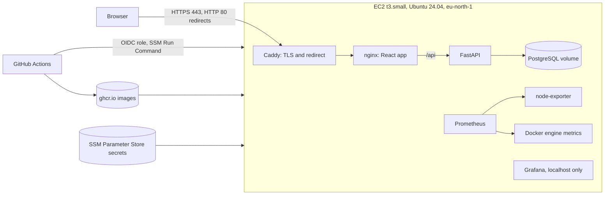

# votesecure-infra

Infrastructure and deploy notes for votesecure-fullstack (React, FastAPI, PostgreSQL) on AWS.
Built as hands-on practice: launched, hardened, deployed, monitored, then torn down to stop the cost.
Everything here was run for real. It is not a long-running production system.

## Architecture

## What is in this repo

- `main.tf`, `network.tf`, `vm.tf`, `variables.tf`, `userdata.sh`: Terraform for the key pair, security group, VM and Elastic IP attachment
- `docker-compose.prod.yml`, `Caddyfile`: the app stack (db, api, web, caddy)
- `monitoring/`: Prometheus, node-exporter and Grafana, listening on 127.0.0.1 only and reached through an SSH tunnel
- `scripts/`: `deploy.sh`, `backup.sh`, `monitoring-up.sh`, `provision.sh`

## How a deploy works

A merge to `main` in the app repo builds the images, scans them with Trivy and pushes them tagged with the commit SHA. The deploy job then assumes an AWS role through OIDC, with no stored keys and a role pinned to the repo's main branch. SSM Run Command runs `deploy.sh` on the VM. The script fetches secrets from Parameter Store into a RAM-disk file, logs in to ghcr.io, pulls, restarts, health-checks over HTTPS, rolls back on failure and deletes the temporary files.

## Security notes

- SSH by key only, root login off, ufw default deny, fail2ban; the security group allows SSH only from my own IP
- Secrets live only in Parameter Store (SecureString) and never in Git
- Only Caddy publishes ports (80 and 443); db, api and web stay internal
- IMDSv2 required; the CI role can run one SSM document on one instance
- Monitoring listens on localhost only

## Rebuild from scratch

Prerequisites, done by hand once:

- AWS account with MFA and an IAM admin user, and the AWS CLI and Terraform installed
- An Elastic IP tagged `Name=votesecure-eip`, and a DNS name pointing at it
- IAM role and instance profile `votesecure-vm-ssm` (AmazonSSMManagedInstanceCore plus read access to `parameter/votesecure/*`)
- Parameter Store SecureStrings `/votesecure/POSTGRES_PASSWORD`, `SECRET_KEY`, `GHCR_TOKEN` and `GRAFANA_ADMIN_PASSWORD`
- GitHub OIDC provider and role `votesecure-ci-deploy`, plus the repo variables `AWS_DEPLOY_ROLE_ARN` and `AWS_INSTANCE_ID`

Steps:

1. Create `terraform.tfvars` with `my_ip_cidr`, then run `terraform init` and `terraform apply`. `userdata.sh` hardens the VM and installs Docker, the AWS CLI, a swap file and Docker's metrics endpoint.
2. Run `./scripts/provision.sh <app-commit-sha>`. It waits for the bootstrap, copies the compose file, Caddyfile, scripts and monitoring folder, deploys the app and starts monitoring.
3. Update the CI role's policy and the `AWS_INSTANCE_ID` variable with the new instance ID.

## Cost and teardown

Paid AWS account with no credits. A t3.small costs about $0.022 per hour, and an Elastic IP about $0.005 per hour even when idle. Stop the VM when idle. When finished, run `terraform destroy` and release the Elastic IP.

## Verified

- Destroyed and rebuilt the VM from code twice. The second rebuild, after adding swap, Docker metrics and the AWS CLI to `userdata.sh`, came up through `provision.sh`, and a CI deploy through SSM succeeded on it.
- Trivy gates every image build, and fixed base-image CVEs were patched instead of silenced.

## Honest limits

- The free duckdns.org subdomain has a valid Let's Encrypt certificate, but Chrome flags it as Dangerous. No real vote was held on it.
- Terraform state is local only. IAM, Parameter Store and the Elastic IP are managed by hand.
- The CI role policy and the `AWS_INSTANCE_ID` variable are tied to one instance ID, so a rebuild needs both updated by hand. Tag-scoping the role would fix that.
- Alerts fire only inside Prometheus. There are no notifications.
- Backups live on the same VM, and a restore was tested once.
